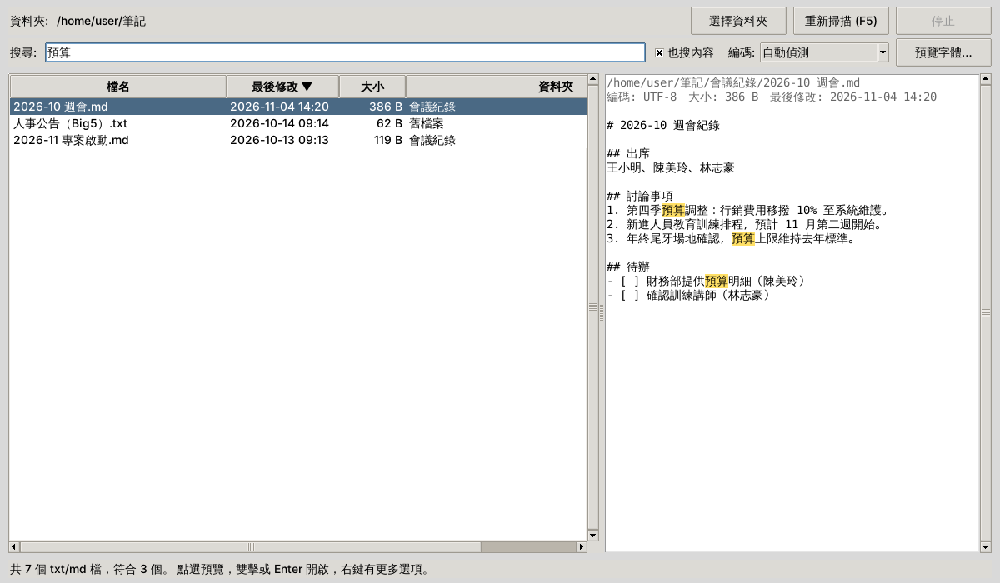
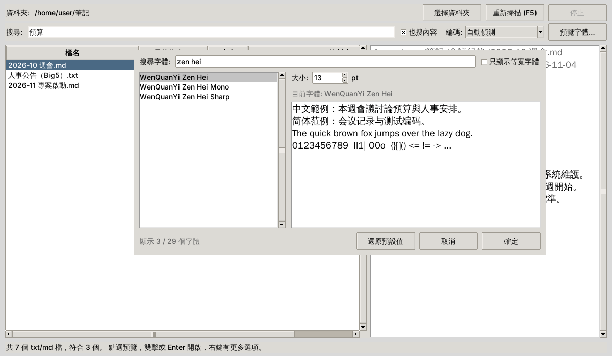

# TextFileScanner（txt/md Dashboard）

一個用 Python + Tkinter 寫的桌面小工具，可以瀏覽、搜尋、預覽和開啟資料夾裡所有的 `.txt` / `.md` 檔案。
繁體中文介面，支援 Windows / macOS / Linux，只用標準函式庫，不需要安裝任何套件。



## 功能

- **掃描資料夾**：列出資料夾和子資料夾中的所有 txt / md 檔。掃描在背景執行，畫面不會卡住，隨時可以停止。
- **即時搜尋**：依檔名或路徑篩選。多個關鍵字用空白分隔，全部符合的檔案才會列出。
- **內容搜尋**：勾選「也搜內容」可以搜尋檔案內文，結果會陸續出現。大檔案分段讀取，不會占用大量記憶體。
- **自動判斷編碼**：支援 UTF-8（含 BOM）、UTF-16 / UTF-32、Big5、Big5-HKSCS、GBK / GB18030。判斷錯誤時，可以從「編碼」選單手動指定。
- **預覽**：唯讀預覽檔案前 60,000 字，搜尋的關鍵字會標示出來。
- **預覽字體**：從電腦已安裝的字體中選擇字型和大小，設定會保存到下次開啟。
- **排序**：點欄位標題可以依檔名、最後修改時間、大小、資料夾排序。
- **開啟檔案**：用系統預設程式開啟。右鍵選單可以開啟所在資料夾或複製完整路徑。



## 需求

- Python 3.10 以上
- Tkinter：Windows 和 macOS 從 python.org 安裝的 Python 已內建。
  Linux 需要另外安裝，例如 Ubuntu / Debian：

  ```bash
  sudo apt install python3-tk
  ```

## 使用方式

最簡單的方式是直接雙擊 `txtmd_dashboard.py`，程式會掃描**它自己所在的資料夾**。
把檔案放在筆記資料夾裡，雙擊就能使用。

也可以從命令列指定要掃描的資料夾：

```bash
python txtmd_dashboard.py "D:\筆記"
```

預設會略過 `.git`、`node_modules` 等資料夾（清單見下方）。要全部掃描的話：

```bash
python txtmd_dashboard.py "D:\筆記" --no-exclude
```

> 💡 在 Windows 上不想看到黑色的命令列視窗，可以把副檔名改成 `.pyw`。

## 快捷鍵

| 按鍵 | 功能 |
|---|---|
| Ctrl+F（macOS：Cmd+F） | 跳到搜尋框 |
| ↓（在搜尋框中） | 移到檔案清單 |
| Enter／雙擊 | 用預設程式開啟檔案 |
| Esc | 清空搜尋；搜尋框已經是空的時，停止掃描或內容搜尋 |
| F5 | 重新掃描 |
| Ctrl + ／ Ctrl − | 放大／縮小預覽文字（也可以按住 Ctrl 捲動滑鼠滾輪） |
| Ctrl+0 | 預覽文字回到預設大小 |

## 預設略過的資料夾

`.git`、`.hg`、`.svn`、`node_modules`、`__pycache__`、`.venv`、`venv`、`.tox`、
`.mypy_cache`、`.pytest_cache`、`.ruff_cache`、`.idea`、`$RECYCLE.BIN`、`System Volume Information`

要調整的話，可以修改程式開頭的 `EXCLUDED_DIRS`。

## 設定檔位置

預覽字體設定存在這裡，刪除後會回到預設值：

| 系統 | 路徑 |
|---|---|
| Windows | `%APPDATA%\txtmd_dashboard\settings.json` |
| macOS | `~/Library/Application Support/txtmd_dashboard/settings.json` |
| Linux | `~/.config/txtmd_dashboard/settings.json` |

## 執行測試

```bash
python -m unittest discover -s tests -v
```

## 授權

[MIT License](LICENSE)
